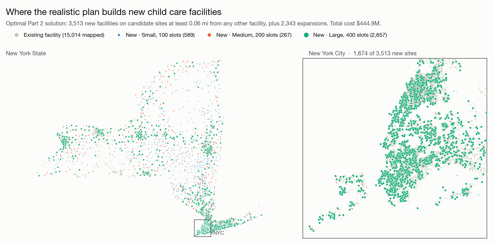
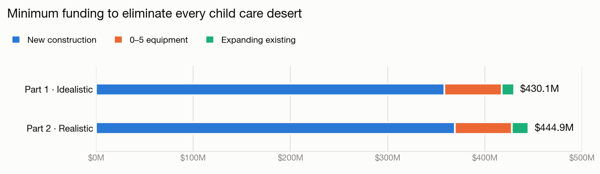

# Eliminating Child Care Deserts in New York State through Optimization

Columbia IEOR E4004 (Optimization Models and Methods), Fall 2025, Project 1. Team project with a classmate.

A ZIP code is a **child care desert** when its regulated child care slots don't cover enough of its children. The assignment asks for the minimum public funding that removes every desert in New York State, under two sets of assumptions. We formulated both as mixed-integer programs and solved them with Gurobi.

<picture>
  <source media="(prefers-color-scheme: dark)" srcset="figures/map_dark.png">
  
</picture>

- **Interactive map:** [chadreadey.github.io/Eliminating-Childcare-Deserts-in-NYS-through-Optimization](https://chadreadey.github.io/Eliminating-Childcare-Deserts-in-NYS-through-Optimization/). Click any ZIP to see its slots today, what the plan adds, and what the state requires.
- Notebook (final submitted version, with outputs): [`Optimization project 1/OptimizationP1.ipynb`](Optimization%20project%201/OptimizationP1.ipynb)
- Written formulation: [`Optimization project 1/Optimization project first two.pdf`](Optimization%20project%201/Optimization%20project%20first%20two.pdf)
- Data: [`Optimization project 1/ChildCareDeserts_Data/`](Optimization%20project%201/ChildCareDeserts_Data)
- Solutions (where each facility is built or expanded): [`results/`](results)

## The problem

Each ZIP must satisfy two requirements:

- **Coverage (ages 0–12):** slots ≥ ½ of children in high-demand ZIPs (employment rate ≥ 60% or average income ≤ $60,000), and ≥ ⅓ elsewhere.
- **Early-childhood policy (ages 0–5):** 0–5 slots ≥ ⅔ of children aged 0–5.

The state can **expand existing facilities** or **build new ones** in three sizes:

| Size | Total slots | Max 0–5 slots | Cost |
|---|---|---|---|
| S | 100 | 50 | $65,000 |
| M | 200 | 100 | $95,000 |
| L | 400 | 200 | $115,000 |

Every new 0–5 slot also needs $100 of equipment.

## Data

| | Count |
|---|---|
| ZIP codes | 1,646 (561 high-demand, 1,085 normal) |
| Regulated facilities in the data | 15,604 (10,363 licensed, 5,172 registered, 69 other statuses) |
| Facilities eligible for expansion (capacity > 0) | 14,789 |
| Candidate sites for new facilities | 215,400 |

Ages 5–12 are estimated as the 5–9 census bucket plus half of the 10–14 bucket.

## Formulations

### Part 1: Idealistic

- New facilities can go anywhere: integer variables `y[zip, size]` count how many of each size to build in each ZIP.
- Each existing facility can expand by up to min(500, 20% of current capacity).
- Expansion costs $200 per added slot, plus a $20,000 baseline (binary indicator) if a facility expands by 100% or more.
- Size: 50,951 variables (19,727 integer), 34,516 constraints.

### Part 2: Realistic

- New facilities can only go on the 215,400 candidate sites, with one binary per site and size and at most one size per site.
- Expansion is capped at 20%, and the cost per slot rises with the size of the expansion. This is modeled as three linear segments (0–10%, 10–15%, 15–20%) with per-slot costs `(20,000 + 200·n)/n`, `(20,000 + 400·n)/n` and `(20,000 + 1,000·n)/n`, where `n` is current capacity. The costs increase from segment to segment, so the cost function is convex and the solver fills the cheaper segments first without ordering constraints.
- **Spacing:** within a ZIP, no two facilities may be closer than 0.06 miles. Conflicts are found with a haversine BallTree:
  - 81,383 pairs of candidate sites, where at most one site of each pair can be built
  - 4,134 candidate sites too close to an existing facility, which are forbidden
- Size: 920,756 variables (646,200 binary), 549,187 constraints.

## Results

Both models solve. The figures below are copied from the notebook's saved outputs.

<picture>
  <source media="(prefers-color-scheme: dark)" srcset="figures/costs_dark.png">
  
</picture>

| | Part 1: Idealistic | Part 2: Realistic |
|---|---|---|
| **Total cost** | **$430,139,450** | **$444,945,613** |
| Expansion | $12,813,250 | $16,954,413 |
| Construction | $358,540,000 | $369,205,000 |
| 0–5 equipment | $58,786,200 | $58,786,200 |
| New facilities (S / M / L) | 3,452 (658 / 277 / 2,517) | 3,513 (589 / 267 / 2,657) |
| Facilities that added slots | see limitation 1 | 2,343 |
| Expansion slots added | 64,066 | 41,640 |
| New-facility slots added | 1,128,000 | 1,175,100 |
| Solve | optimal, 0.2 s | 0.0075% gap (within Gurobi's default 0.01%), 157 s |

Part 2 costs about $14.8M (3.4%) more than Part 1. Capping and pricing expansions more steeply shifts capacity toward new construction, and the spacing rules leave fewer places to put it. Both parts add the same number of 0–5 slots (587,862), because the ⅔ early-childhood requirement is the binding one in most ZIPs.

Hardware: Apple M3 Max, Gurobi 12.0.3, academic license.

In October 2026 we re-ran the submitted notebook unchanged on the same machine to export the solutions. Both parts reproduced the same objectives and facility counts; Part 2 finished in 151 s with a proven gap of 0.0097%, inside the same 0.01% tolerance. The exports in [`results/`](results) are:

- `part2_new_facilities.csv`: each new site built in Part 2, with its ZIP, coordinates, size and 0–5 slots
- `part2_expansions.csv`: each expanded facility, with slots added per cost segment and the 0–5 slots among them
- `part1_new_by_zip.csv`: the number of S, M and L facilities Part 1 builds in each ZIP

The plan is unique at the ZIP level, but not at the site level. Two re-runs built exactly the same number of each size in every ZIP and the same expansions, but chose different candidate sites inside some ZIPs: many sites in a ZIP cost the same, so the solver's pick among them is arbitrary. The maps show one of these equally cheap choices.

## Known limitations

These are modeling choices and gaps in the submitted version.

1. **Part 1 reads the expansion cap as +20%.** The assignment says expansions are limited to "120% of current capacity", and that a $20,000 baseline applies to expansions of 100% or more. We implemented the cap as min(500, 0.2 × current). Under that cap a facility can never reach a 100% expansion, so the baseline never applies. The notebook's "Facilities expanded: 0" line counts baseline activations, not facilities that added slots (64,066 slots were added). If the cap is read as 120% *added* capacity, expansion becomes much larger and Part 1 would likely cost less.
2. **Part 1 charges a flat $200 per slot.** The assignment also says larger facilities should be cheaper to expand per slot. Part 1 follows our written formulation, which uses a constant $200; Part 2 uses the assignment's size-dependent formula. As a result, expansion costs in the two parts aren't on the same basis.
3. **Part 2 prices expansion by increments.** We apply each segment's rate only to the slots inside that segment. The assignment's formula can also be read as charging the whole expansion at the rate of the highest segment reached. That reading costs more and makes the cost function non-convex.
4. **Spacing is approximate.** A candidate site within 0.06 miles of an existing facility is removed outright. 590 existing facilities have no coordinates, so their spacing isn't checked. As the assignment specifies, spacing is only enforced within a ZIP.
5. **The coverage counts in the output are mislabeled.** "ZIPs meeting coverage threshold" (57 in Part 1, 41 in Part 2) actually counts ZIPs that sit *exactly* at the threshold. Coverage and policy are hard constraints, so every ZIP satisfies them in both solutions.
6. **The optional fairness extension** ($2.2B budget and a 0.1 cap on coverage gaps between areas) was not attempted.

## Running it

```bash
pip install -r requirements.txt
cd "Optimization project 1"
jupyter notebook OptimizationP1.ipynb
```

To redraw the figures from `results/` (no Gurobi needed), run `python figures/make_figures.py` from the repo root. To rebuild the interactive map's data, run `python docs/build_data.py`.

Both models are far larger than the free size-limited `gurobipy` license allows (2,000 variables), so you need a full Gurobi license, such as a free academic one, at `~/gurobi.lic`. Part 2 takes about 3 minutes on a 16-core machine.
